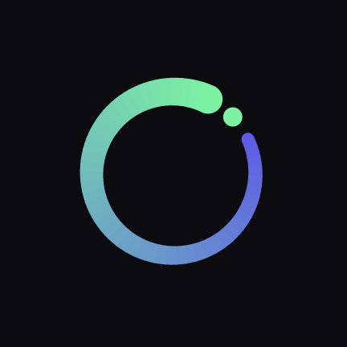
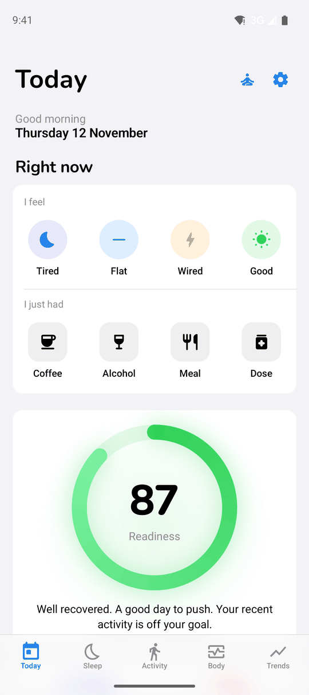
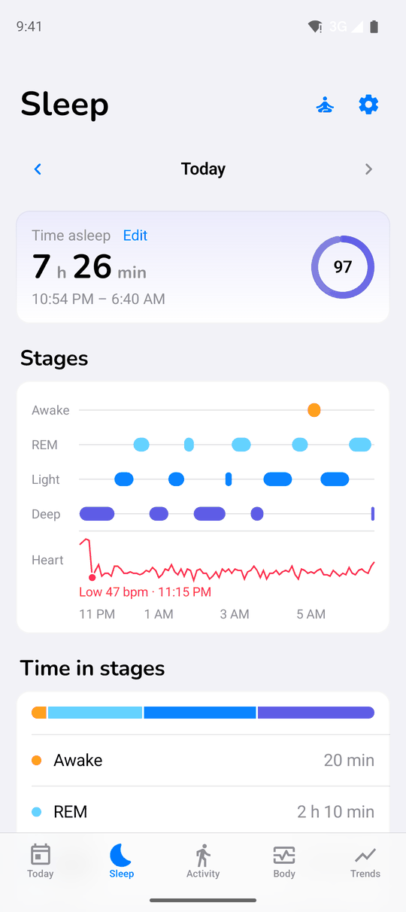
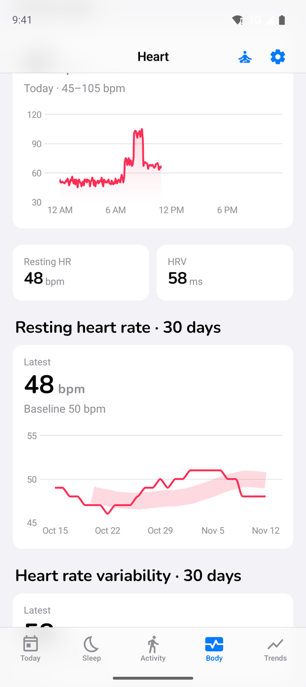
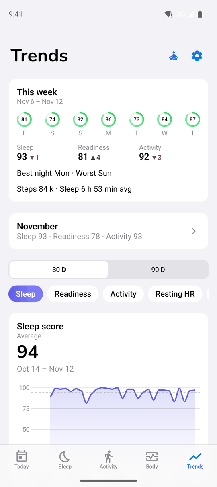
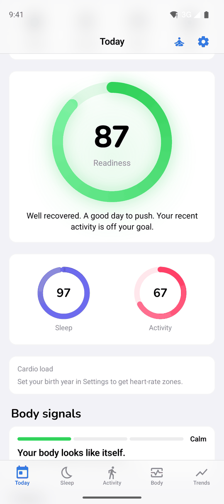
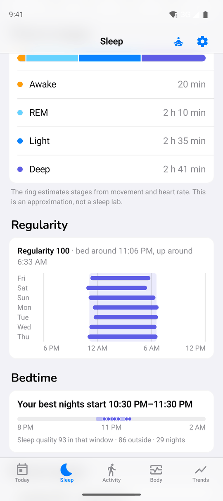
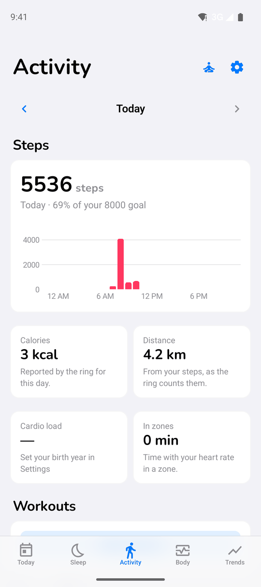
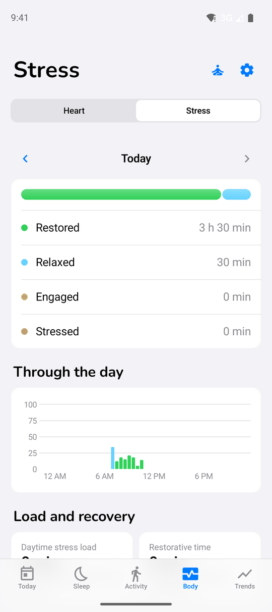
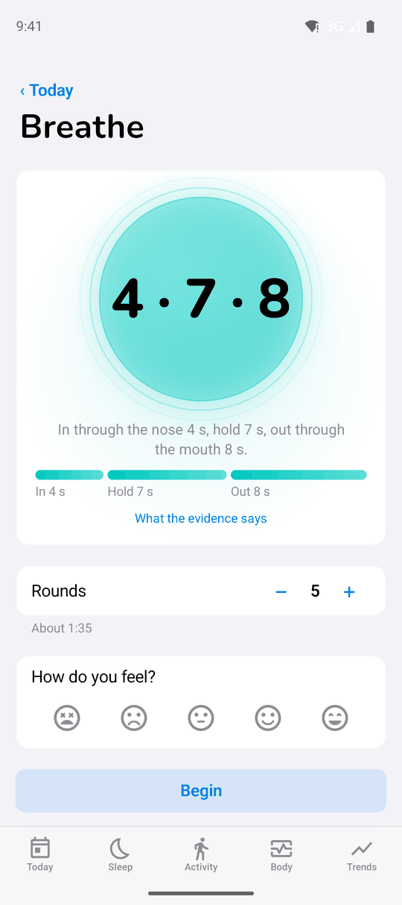

<div align="center">



# Circa

**A $20 smart ring, your own server, and a health app that tells you something useful.**

[](https://github.com/gdwrd/circa-health/actions/workflows/ci.yml)
[](https://github.com/gdwrd/circa-health/releases)


[](LICENSE)






</div>

---

The Colmi R02 is a smart ring that costs less than lunch for two. It records your
heart rate, HRV, SpO₂, stress, steps and sleep all day. Its own app shows you the
numbers and leaves it there.

**Circa** turns those numbers into answers:

- 🌙 **How did I sleep?** A Sleep score, a stage-by-stage hypnogram and your best bedtime window.
- 🔋 **Am I recovered?** A Readiness score built on resting heart rate, HRV and sleep debt.
- 🏃 **Did I move enough?** Activity, workouts it detects on its own, and time in heart-rate zones.
- 🧠 **Why do I feel like this?** One-tap tags for coffee, alcohol, meals and doses, matched against what the ring saw.

All of it runs on **your own hardware**. You get no vendor cloud, no account, no
subscription and no telemetry. The app talks to a small Docker backend on your
NAS, Raspberry Pi or homelab, and your data never leaves your network.

> Every score is compared with **your own trailing 14 days**, not with a population
> average. It is an approximation, not a medical device.

## A tour

<table>
<tr>
<td width="33%" valign="top"><br><b>Today</b><br>Say how you feel or what you just had in one tap, then see your Readiness for the day.</td>
<td width="33%" valign="top"><br><b>Scores and vitals</b><br>Sleep, Readiness and Activity at a glance, plus heart rate, HRV, SpO₂ and ring battery.</td>
<td width="33%" valign="top"><br><b>Sleep</b><br>Time asleep, stages and heart rate through the night. Fix the bed and wake times if the ring got them wrong.</td>
</tr>
<tr>
<td valign="top"><br><b>Regularity and bedtime</b><br>See how consistent your nights are and which bedtime window gives you your best sleep.</td>
<td valign="top"><br><b>Activity</b><br>Steps hour by hour, calories, distance, and the walks, rides and runs it detects, which you can relabel.</td>
<td valign="top"><br><b>Heart</b><br>Heart rate through the day, with resting HR and HRV over 30 days against your baseline.</td>
</tr>
<tr>
<td valign="top"><br><b>Stress</b><br>Time restored, relaxed, engaged or stressed through the day, plus load, recovery and resilience.</td>
<td valign="top"><br><b>Trends</b><br>This week against last week, monthly summaries, and 30- or 90-day charts for every score.</td>
<td valign="top"><br><b>Breathe</b><br>A guided 4-7-8 breathing session that tracks your heart rate while you do it.</td>
</tr>
</table>

<sub>The screenshots show synthetic demo data.</sub>

### Also in the box

- 📱 **Home-screen widgets**: a score ring and a one-tap "mark" widget.
- 🔔 **Notifications** from your backend: a low ring battery, reminders, signals worth a look.
- 🔄 **Sync every 5 minutes**: the app wakes, drains the ring's buffer, posts the samples to your server, and disconnects.
- 🛌 **Phone as sleep sensor** (optional): screen on/off times fix the nights you scrolled in bed.
- 🧪 **Experiments**: A/B-test a habit and see whether it really changes your sleep or recovery.
- 📤 **Your data, your format**: one SQLite file, a CSV export, and a plain HTTP API.

## How it works

```
┌───────────┐   BLE    ┌───────────┐  samples + bearer token  ┌───────────────────┐
│ Colmi R02 │ ───────▶ │  Android  │ ───────────────────────▶ │   your backend    │
│   ring    │          │    app    │ ◀─────────────────────── │ FastAPI + SQLite  │
└───────────┘          └───────────┘     scores read back     │     (circa.db)     │
                                                              └───────────────────┘
```

The wire format is simple: the app **POSTs Prometheus text** to
`/api/v1/import/prometheus`. The backend stores every sample in one SQLite file
(`circa.db`) and, after each push, recomputes the scores for the affected days,
which the app reads back through the other routes.

- **`SyncWorker`** — an `androidx.work` worker that self-chains one-time work every
  5 minutes (a `PeriodicWorkRequest` cannot fire faster than 15 minutes).
- **`ColmiConnection`** — wraps the Android `BluetoothGatt` API in coroutine
  channels so the request/notify dance reads as straight-line code.
- **`ColmiProtocol`** — packet builders and parsers for the Colmi R0x wire format.
- **`MetricsPusher`** — posts the Prometheus text lines to the backend.
- **`Prefs`** — persists the ring MAC, the backend URL and a per-metric "last
  synced" cursor so the same samples are never re-pushed.

The ring keeps roughly the last 24 hours of detailed samples in its own flash.
Each sync pulls today plus yesterday; the cursor de-dupes what was already sent.

## Requirements

- **Ring**: Colmi R02 (other R0x variants likely work — same protocol family).
- **Phone**: any Android device running Android 12 or newer (API 31+).
- **Server**: any machine that can run Docker — a homelab box, a NAS, a
  Raspberry Pi-class board or a PC — reachable from the phone, on the LAN or over
  a VPN such as Tailscale.

## Quick start

### 1. Run the backend

On the server, with the repo (or just `infra/` + `backend/`) in place:

```bash
cd infra
cp .env.example .env
# set API_TOKEN to a long random string in .env (optional: set TZ)
docker compose up -d --build
```

The backend listens on port `8429`.

### 2. Install the app

Download the latest APK from the [GitHub Releases page](https://github.com/gdwrd/circa-health/releases),
or build it yourself (see **For Developers**).

### 3. First-time setup

1. Launch **Circa** and grant the Bluetooth and notification permissions.
2. Tap **Scan for ring** and pick your Colmi R02.
3. Enter your backend URL, e.g. `http://<server-ip>:8429`, and the `API_TOKEN`
   from `infra/.env`.
4. Save the settings, then tap **Sync now**.

### 4. Check it works

```bash
docker exec circa-backend python -c "import sqlite3;print(sqlite3.connect('/data/circa.db').execute(\"select count(*) from samples where metric='biometric_hr_bpm'\").fetchone())"
```

The count climbs after each sync.

## Privacy and your data

Everything lives on your server. Every sample and every computed score is stored
in `circa.db`, held in the `backend-data` Docker volume. There is nothing to
opt out of — the app has no vendor endpoint to talk to.

- **Backup**: `docker cp circa-backend:/data/circa.db .`
- The backend also keeps a dated daily copy in `/data/backups/` (last 14 days),
  inside the same volume, so copy it off the server too.
- **Warning**: never run `docker compose down -v` — the `-v` flag deletes the
  `backend-data` volume and with it all of your ring data.

Permissions the app asks for, and why:

| Permission | Why |
| --- | --- |
| `BLUETOOTH_SCAN` (not used for location) | Find and talk to the ring over BLE. |
| `BLUETOOTH_CONNECT` | Read samples from the ring. |
| `FOREGROUND_SERVICE` + `FOREGROUND_SERVICE_CONNECTED_DEVICE` | Keep the 5-minute BLE sync running in the background. |
| `INTERNET` / `ACCESS_NETWORK_STATE` | Reach your backend and know when a network is available. |
| `POST_NOTIFICATIONS` | Show reminders and sync alerts. |
| `REQUEST_IGNORE_BATTERY_OPTIMIZATIONS` | Keep the 5-minute sync on schedule. |
| `PACKAGE_USAGE_STATS` | Read screen on/off events to tell "phone in bed" from real sleep (no location, no app list). |
| `ACTIVITY_RECOGNITION` | Notice rides and walks from activity transitions, without location. |

## For Developers

### Repository layout

| Path | What it is |
| --- | --- |
| `app/` | Android app (Kotlin, Jetpack Compose). |
| `backend/` | FastAPI service (Python). |
| `infra/` | `docker-compose.yml` and the `.env` template. |
| `docs/` | The plans. |
| `.github/` | CI and release workflows. |

### Build the app

You need Android Studio, the Android SDK (platform 35), JVM 17, and a phone with
USB debugging enabled.

```bash
./gradlew :app:assembleDebug
adb install -r app/build/outputs/apk/debug/app-debug.apk
```

The application id and Kotlin package are both `com.nsheremet.circa`. Release
builds must be signed with the same key every time, or Android refuses the upgrade.

### Tests

```bash
# App (Robolectric UI tests, run on the JVM, no device needed)
./gradlew :app:testDebugUnitTest

# Backend
pip install -r backend/requirements.txt
python -m pytest backend/tests -q
```

### Backend API

All routes require `Authorization: Bearer <API_TOKEN>` except `GET /health`.

| Method | Path | Purpose |
| --- | --- | --- |
| GET | `/health` | Liveness probe (no token). |
| POST | `/api/v1/import/prometheus` | Ingest Prometheus text samples, then rescore the affected days. |
| GET | `/today?date=` | The main card: today's scores, contributors, vitals, journal, signals. |
| POST | `/guess` / `/guess/verdict` | Record this morning's readiness guess and the evening answer. |
| GET / PATCH / DELETE | `/sleep?date=` | Read a night, override its bed/wake times, or remove the override. |
| GET | `/activity?date=` | Hourly steps, calories and distance. |
| GET | `/stress?date=` | Stress samples for a day. |
| GET | `/hr?hours=` / `?date=` | Heart-rate points. |
| POST | `/breathe` | Log a guided breathing session. |
| GET | `/trends?metric=&days=` | A score or input metric over time. |
| GET | `/week?end=` / `/month?month=` | Week and month summaries (each vs the previous). |
| GET | `/export.csv?days=` | One CSV row per day. |
| GET / POST | `/journal?days=` | Read or add journal entries. |
| DELETE | `/journal/{id}` | Delete a journal entry. |
| GET | `/journal/insights` / `/journal/bp?days=` | Per-kind journal insights and blood-pressure points. |
| GET | `/marks` | The user's named "things" and their marks. |
| GET / POST / DELETE | `/experiments` | A/B experiments on a journal habit. |
| GET / PATCH | `/settings` | Read or update settings (goals, sleep need, birth year, ...). |
| PATCH / POST | `/workouts` | Relabel a detected workout or add one by hand. |
| PUT | `/notes/{key}` | Save a note for the next time a signal recurs. |
| GET | `/notifications/pending` | Pending notifications for the app. |
| POST | `/notifications/{id}/ack` | Acknowledge a notification. |

### CI and releases

- **CI** (`.github/workflows/ci.yml`) runs on every push and pull request: it
  unit-tests and builds the app, then compiles, tests and Docker-builds the backend.
- **Releases** (`.github/workflows/release.yml`) run when you push a `v*` tag.
  It signs the release APK using the repository secrets `KEYSTORE_BASE64`,
  `KEYSTORE_PASSWORD`, `KEY_ALIAS` and `KEY_PASSWORD`, verifies the signing
  certificate, and attaches the APK to the GitHub release.

### Stack

- **App**: Kotlin, Jetpack Compose + Material3, Android 12+, JVM 17.
- **Backend**: Python 3.12, FastAPI, `sqlite3` (standard library), `httpx`.

## Notes and caveats

- The ring will not talk to two BLE clients at once. Uninstall (or at least
  unpair from) Gadgetbridge or the official Colmi app before using this one.
- `minSdk = 31` because `BLUETOOTH_CONNECT` is an API-31 runtime permission.
- Cleartext HTTP is allowed by the network security config so you can point the
  app at a local backend over plain HTTP. If you front your endpoint with TLS,
  you can tighten `app/src/main/res/xml/network_security_config.xml`.
- A score that needs a baseline stays empty ("learning") until at least 5 of the
  trailing 14 days have data, so expect the first week to be incomplete.
- The scores are approximations against your own 14-day baselines, not medical
  advice. This is a personal project, not a medical device. Do not make health
  decisions off these numbers.

## Credits

- Protocol details reverse-engineered by the
  [Gadgetbridge](https://gadgetbridge.org/) community (GPL-3.0).
- [jonas-werner/ring-health-tracker](https://github.com/jonas-werner/ring-health-tracker),
  the project Circa started from. Thank you!
- AndroidX, OkHttp — thanks to all the maintainers.

## License

MIT — see [`LICENSE`](LICENSE).
